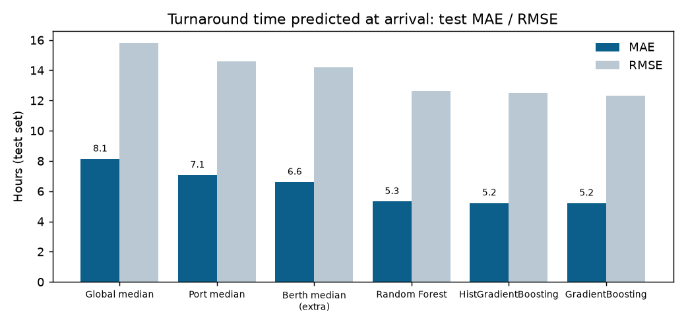

# Results

All numbers are from the test set (November–December 2019). Models were chosen on September–October data, and the test set was used once. The source files are in `reports/`.

## Headline: liner ships (container and cruise)

**How long will a ship stay, predicted the moment it berths?** (3,886 test visits, median stay 12.8 h)

| Model | MAE (h) | RMSE (h) | Within 1 h |
|---|---:|---:|---:|
| Global median | 8.13 | 15.79 | 9.5% |
| Port median | 7.06 | 14.59 | 21.2% |
| Random Forest | 5.31 | 12.63 | 26.5% |
| HistGradientBoosting | 5.21 | 12.48 | 29.0% |
| **GradientBoosting** | **5.20** | **12.33** | 28.4% |

- **Overall:** GradientBoosting is 26% more accurate than the port median, with a median error of 2.5 h.
- **Cruise ships** run fixed timetables: median error 0.8 h, and 56% are predicted within 1 h.
- **Container ships** have a median error of 3.4 h.
- **MAE vs RMSE:** RMSE is larger than MAE because a few very long stays (repairs, lay-ups) are hard to predict.

| Other liner results | |
|---|---|
| Hours left while alongside | **5.60 h** MAE (RMSE 13.2), vs 6.90 h for the berth median and 7.30 h for the port median |
| Ports never seen in training (16) | Model 12.4 h vs baseline 15.4 h, so it generalises to new ports |
| "Clears within 6 h" | Precision 0.65, recall 0.76, PR-AUC 0.75 (positive rate 25%) |
| Clearance window coverage | 25% / 50% / 90% times were right 22% / 47% / 89% of the time |
| **Speed simulation (simulated)** | Waiting at anchor −21%, fuel −6.6% (2.9 t per arrival), about **$1,550 net saved per arrival**: 51% of what a perfect forecast would save |

## Lower confidence: tankers, bulk carriers, general cargo

These ships stay longer (median 35 h) and less predictably.

| Turnaround at arrival | MAE (h) | RMSE (h) |
|---|---:|---:|
| Global median | 25.67 | 44.76 |
| Port median | 23.35 | 42.99 |
| **Random Forest** | **18.91** | **38.56** |
| HistGradientBoosting | 19.02 | 38.41 |
| GradientBoosting | 19.01 | 38.29 |

- **Hours left while alongside:** 19.6 h MAE, against 21.5 h for the berth median.
- **"Clears within 6 h":** PR-AUC 0.49.
- **Clearance window:** coverage is on target, at 25/50/90%.
- **Speed simulation:** fuel −30%, wait −14%, about $2,490 net saved per arrival. These ships wait longer, so there's more to save, but the forecasts behind it are less reliable.

## What the experiments showed

- **Algorithms:** Random Forest, HistGradientBoosting, GradientBoosting and XGBoost all land within about 0.1 h of each other. The limit is the information in the data, not the algorithm.
- **Imbalance handling (E08–E09):**
  - For liner ships, every resampling strategy scored within 0.003 PR-AUC of the others. SMOTE + Tomek links was marginally best.
  - For other ships, no resampling was best.
  - Resampling distorts probabilities, so the chosen classifier is recalibrated on untouched data.
- **Scaling (E04):** no measurable difference. Ridge regression is effectively scale-invariant here, and tree models are by design.
- **Long stays:** removing stays over 7 days from training helped. They are lay-ups and repairs, not normal turnarounds.

## Limitations

- **Anchorage waits aren't in the data.** Port calls only cover stops within about 600 m of a quay. The simulation derives waits from predicted vs actual berth clearance, so the fuel and money figures are **simulated**, not measured.
- **Fuel figures are estimates.** Engine figures per ship type are illustrative. Real ships need their own fuel curves.
- **Not hour-perfect.** Departures depend on cargo volumes, crane and labour plans and schedules, none of which are in public data.
- **Missing ship types.** Vessel type is known for only 47% of ships. The unknown ones are excluded.
- **Three demo ports have no ship positions** in the dataset (Cartagena, Kingston, San Juan). The API uses the nearest port with data and says so.
- **Replay only.** The API replays 2019; there is no live ship-tracking feed yet.
- **Tankers and bulk carriers** are rough forecasts and are labelled lower confidence.

## Where to read more

| File | What's in it |
|---|---|
| `reports/phase1/PHASE1_AUDIT.md` | What one record means, and why only commercial ships are used |
| `reports/leakage_check.md` | Every feature and why it's known at prediction time |
| `reports/E10_final_test_<segment>.md` | Full test report, errors by type, checkpoint and port |
| `reports/turnaround_comparison_<segment>.md` | The turnaround model comparison |
| `reports/E11_simulation_<segment>.md` | The speed simulation and its assumptions |
| `experiments/experiments.csv` | Every experiment run, one row each |
